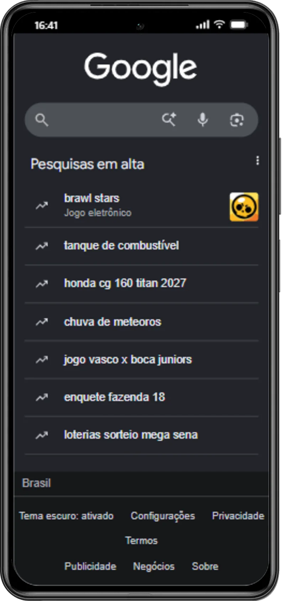

# Phone Simulator

Extensão para o Google Chrome (Manifest V3) que mostra **qualquer site dentro de um aparelho simulado** — iPhone, Android e tablets — com moldura realista, status bar, teclado virtual, captura de tela e gravação de vídeo.

Diferente do modo responsivo do DevTools, o site abre numa aba normal (mesmo domínio, mesmos cookies e login), dentro de uma moldura de aparelho de verdade, com o `User-Agent` e as APIs do navegador falsificados para o dispositivo escolhido.

<p align="center">
  
</p>

> Captura gerada pela própria extensão (Google aberto num Xiaomi Mi 11i).

---

## Sumário

- [Recursos](#recursos)
- [Instalação](#instalação)
- [Como usar](#como-usar)
- [Catálogo de aparelhos](#catálogo-de-aparelhos)
- [Barra de ferramentas](#barra-de-ferramentas)
- [Teclado virtual](#teclado-virtual)
- [Vários aparelhos na mesma aba](#vários-aparelhos-na-mesma-aba)
- [Captura de tela e gravação](#captura-de-tela-e-gravação)
- [Arquitetura](#arquitetura)
- [Estrutura do projeto](#estrutura-do-projeto)
- [Privacidade](#privacidade)
- [Limitações conhecidas](#limitações-conhecidas)

---

## Recursos

- **61 aparelhos** com moldura própria (PNG @2x) e recorte de tela por máscara SVG — notch, Dynamic Island e cantos arredondados reais.
- **Spoofing completo** de `navigator.*`, `screen.*`, `devicePixelRatio`, `matchMedia` de ponteiro e `User-Agent` (cabeçalho HTTP + client hints).
- **Teclado virtual** no estilo iOS / Gboard, com animação de entrada e teclado numérico automático.
- **Até 6 aparelhos lado a lado** na mesma aba, com sincronização opcional de rolagem, cliques, digitação e navegação.
- **Captura de tela** (PNG/WebP) com a moldura do aparelho, seguida de um **editor de imagem** (retângulo, seta, linha, texto, cores, desfazer).
- **Gravação de vídeo** (WebM) do aparelho, com opção de áudio da aba.
- **Girar** (retrato ⇄ paisagem) e **zoom** ajustado automaticamente à tela.
- Funciona em qualquer página `http`/`https` sem configuração.

---

## Instalação

A extensão não está publicada na Chrome Web Store; carregue a pasta localmente:

1. Abra `chrome://extensions` e ative o **Modo do desenvolvedor** (canto superior direito).
2. Clique em **Carregar sem compactação** e selecione esta pasta.
   - No Windows com WSL: `\\wsl.localhost\Ubuntu\home\rayan\project\Pessoal\phone-simulator`.
3. Fixe o ícone na barra do Chrome.

> Ao atualizar os arquivos, volte em `chrome://extensions` e clique em **↻ (recarregar)** no card da extensão, depois recarregue a aba.

---

## Como usar

Em qualquer página `http`/`https`, clique no ícone da extensão para **ligar** o simulador. A página é recarregada dentro da moldura do aparelho. Clique de novo para **desligar** e voltar ao site normal.

O selo **ON** no ícone indica que o simulador está ativo naquela aba. Cada aba é independente.

---

## Catálogo de aparelhos

São **61 aparelhos**, divididos em grupos no painel de seleção:

| Grupo | Qtd. | Exemplos |
| --- | --- | --- |
| iPhone | 34 | iPhone 5 → iPhone 15 Pro Max |
| iPad | 2 | iPad / iPad Pro |
| Telefones Android | 23 | Galaxy S, Pixel, etc. |
| Tablets | 2 | Tablets Android |

No total: **36 aparelhos iOS** e **25 Android**. Padrão: **iPhone 15**.

Cada aparelho guarda sua tela (`width`/`height` em CSS px + `dpr`), a moldura (`device.png` @2x, com `left`/`top` indicando onde a tela começa) e as máscaras SVG de recorte (`path` para retrato, `pathL` para paisagem). O catálogo e as molduras foram extraídos de uma extensão comercial de referência para reproduzir fielmente o visual.

---

## Barra de ferramentas

Barra de ícones circulares à **direita** da tela.

De cima para baixo: **sair**, **trocar aparelho**, **detalhes do aparelho**, **girar**, **zoom**, **capturar tela**, **gravar**, **modos**.

No rodapé: **copiar endereço**, **ajuda** e **Configurações** (engrenagem) — que abre o campo de endereço, os botões voltar/avançar/recarregar e as opções **Sincronizar interações**, **Teclado virtual** e **Gravar com áudio**.

As ações que mexem num aparelho (girar, capturar, gravar, trocar modelo, endereço) atuam no **aparelho ativo**.

---

## Teclado virtual

Ao focar um campo de texto, sobe um teclado no estilo do sistema (iOS ou Gboard) com **animação** de entrada, e o site encolhe para dar lugar a ele, como num celular de verdade.

As teclas digitam de verdade no campo focado. Campos `tel`/`number`/`inputmode="numeric"` abrem o teclado numérico. Dá para desligar em **Configurações → Teclado virtual**.

---

## Vários aparelhos na mesma aba

No painel **Aparelhos**, o botão **＋** adiciona um novo aparelho na aba — até **6 lado a lado**. Os círculos "Dispositivos visíveis na aba" mostram cada um; clicar num deles o deixa **ativo** (anel azul). O **✕** no canto de cada aparelho o remove.

Com **Sincronizar interações** ligado, a rolagem, os cliques, a digitação e a navegação feitos num aparelho se repetem nos outros — útil para comparar o mesmo fluxo em telas diferentes. Cada aparelho tem seu próprio teclado virtual e vê o seu próprio `navigator`/`screen` no JavaScript.

---

## Captura de tela e gravação

**Captura (PNG/WebP):** monta no canvas a `device.png` + a tela recortada em @2x, produzindo uma imagem **com a moldura do aparelho**. Em seguida abre um **editor**: ferramentas de retângulo, seta, linha e texto, 8 cores, espessura ajustável, desfazer/limpar, copiar para a área de transferência (`ClipboardItem`) e salvar em PNG ou WebP. Atalhos `Ctrl+Z` e `Esc`.

**Gravação (WebM):** usa `chrome.tabCapture` para capturar a aba, recorta apenas a região do aparelho no canvas e grava com `MediaRecorder` (VP9/VP8 + Opus). A opção **Gravar com áudio** inclui o som da aba (roteado de volta para as caixas via `AudioContext` para você continuar ouvindo). O recorte usa escala uniforme + centralização para evitar barras pretas.

---

## Arquitetura

| Peça | Papel |
| --- | --- |
| `background.js` | Service worker (MV3). Liga/desliga o simulador por aba, cria as regras de rede (`declarativeNetRequest`, só naquela aba), injeta a UI e trata as mensagens da UI (estado, aparelhos, captura, stream de gravação). |
| Regras de rede | **Página de cima:** CSP `script-src 'none'` — o site não roda nela; ela vira só a "casca" do simulador. **Iframe:** remove `X-Frame-Options`/CSP para o site abrir embutido. **Tudo:** troca `User-Agent` e client hints pelo do aparelho. |
| `sim/ui.js` + `sim/ui.css` | A UI injetada: troca o conteúdo da aba pelos aparelhos centralizados (moldura, status bar iOS, Dynamic Island) com o site num iframe do **mesmo domínio** (mantém cookies e login). Gerencia as janelas, o teclado, a barra de ferramentas, o editor de imagem e a gravação. |
| `inject/spoof.js` | Content script `world: "MAIN"`, roda antes do site em todos os frames. No iframe do simulador (identificado pelo `window.name`), falsifica `navigator.*`, `screen.*`, `devicePixelRatio`, `matchMedia` de ponteiro e `frameElement`, e faz a ponte `postMessage` com a UI (endereço, teclado, sincronização). |
| `sim/devices.js` | Catálogo dos 61 aparelhos e geração do `User-Agent`. Carregado pelo service worker (`importScripts`) e pela UI (`scripting.executeScript`). |

**Fluxo de uma aba simulada:** clique no ícone → `background.js` aloca as regras de rede e recarrega a aba → a página de cima vira a casca (sem scripts do site) → `background.js` injeta `ui.css`/`ui.js` → a UI monta a moldura e abre o site num iframe → `spoof.js` falsifica as APIs dentro do iframe.

---

## Estrutura do projeto

```
phone-simulator/
├── manifest.json          # MV3: permissões, web_accessible_resources, content script
├── background.js          # service worker (regras de rede, ciclo de vida, mensagens)
├── inject/
│   └── spoof.js           # spoofing de navigator/screen + ponte postMessage
├── sim/
│   ├── devices.js         # catálogo dos 61 aparelhos + User-Agent
│   ├── ui.js              # UI injetada (janelas, teclado, captura, gravação, editor)
│   └── ui.css             # estilos da UI (tema escuro)
├── assets/devices/<slug>/
│   ├── device.png         # moldura @2x do aparelho
│   └── terminal-mini.png  # miniatura para o seletor
├── icons/                 # ícones da extensão (16/32/48/128)
└── README.md
```

---

## Privacidade

A extensão roda **inteiramente no seu navegador**. Não envia nenhum dado para servidores externos. As preferências (aparelhos escolhidos, zoom, opções) ficam em `chrome.storage.local`/`session`. As permissões pedidas servem só ao funcionamento local:

- `declarativeNetRequest` — trocar cabeçalhos **apenas na aba simulada**.
- `scripting` — injetar a UI na aba.
- `tabs` / `activeTab` / `webNavigation` — saber quando a aba navega e recarregá-la.
- `tabCapture` — gravar a aba (só quando você pede).
- `storage` — lembrar suas preferências.
- `<all_urls>` — funcionar em qualquer site.

---

## Limitações conhecidas

- Com vários aparelhos, o cabeçalho HTTP `User-Agent` segue o **1º aparelho**, porque as regras de rede do Chrome valem por aba e não por iframe. O JavaScript de cada aparelho vê o seu próprio. (A extensão de referência tem a mesma limitação.)
- Se o site monta um HTML diferente em cada tamanho de tela, o caminho CSS pode não existir nos outros aparelhos; nesse caso aquele clique ou digitação não é repetido.
- Editores de texto rico (`contenteditable`) e rolagem dentro de áreas internas da página não são sincronizados.
- As media queries **CSS** `pointer`/`hover` continuam vendo mouse; só o `matchMedia` via JS foi ajustado. A largura (`max-width`) funciona normalmente.
- O site renderiza com o DPR real do seu monitor; `devicePixelRatio` é falsificado só para o JS.
- Não há eventos de toque: o mouse continua gerando cliques normais.
- Workers do site ainda veem o `User-Agent` real no JS (o cabeçalho HTTP é trocado).
- Emulação completa (CSS de toque, DPR real) exigiria a API `chrome.debugger`, que mostra uma faixa de aviso no navegador.
